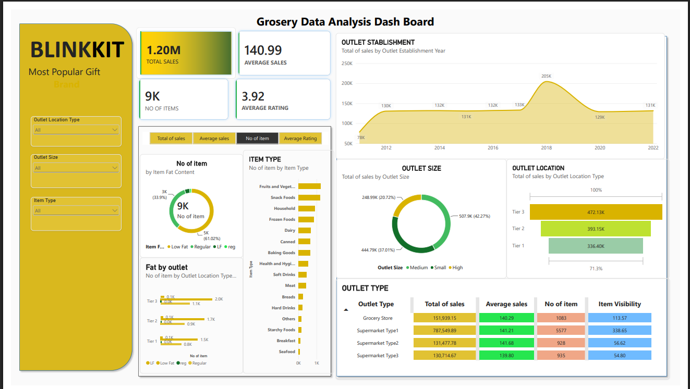

Blinkit Grocery Data Analysis Dashboard

Project Overview
This project focuses on analyzing Blinkit grocery sales data using Microsoft Power BI.

The dashboard provides insights into sales performance, outlet characteristics, item types, and customer ratings.

Dashboard Preview

Key Performance Indicators (KPIs)
- Total Sales: 1.20M
- Average Sales: 140.99
- Number of Items: 9K
- Average Rating: 3.92

Dashboard Features
- Total Sales Analysis
- Average Sales Analysis
- Item Fat Content Analysis
- Item Type Analysis
- Outlet Establishment Analysis
- Outlet Size Analysis
- Outlet Location Analysis
- Outlet Type Performance

Tools and Technologies
- Microsoft Power BI
- Power Query
- DAX
- Data Visualization

Files Included
- Power BI Dashboard (.pbix)
- Dashboard Preview (.png)
- Dataset (if permitted)
Author
S.B.R. Gayan Aroshana

Business Intelligence Student
